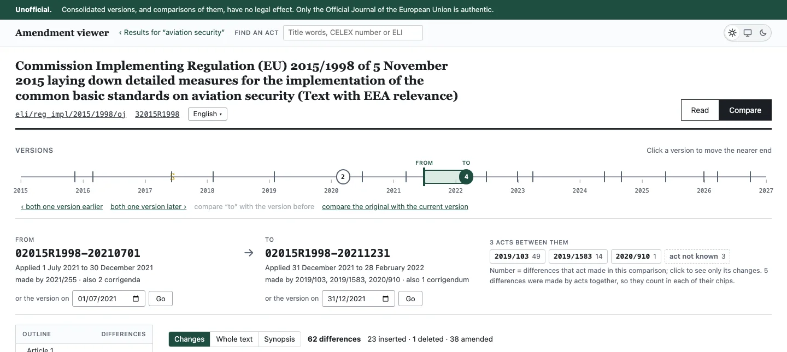
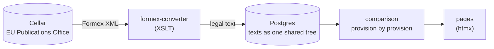

<!-- SPDX-License-Identifier: MIT -->

# EU Legislation Viewer

Compare any two versions of an EU act, provision by provision, and see exactly what changed and when.

<picture>
  <source media="(prefers-color-scheme: dark)" srcset="docs/images/hero-dark.webp">
  
</picture>

## Why

EUR-Lex publishes each consolidated version of an act, but not what changed between two of them. Finding out means
reading both side by side, then working back through the amending acts to learn which one made a change, and from when
it applies.

The viewer does that work: pick two dates, and it shows each difference in place, the act that made it, and when it
took effect, in any of the EU's official languages the act was published in.

## How it works



An act's text is fetched from Cellar the first time someone asks for it, converted from Formex, and stored as a tree that
every version shares, so an unchanged provision is stored once and two versions compare quickly.

## Develop

Java 25, Spring Boot and Spring Modulith, Postgres, htmx; built with Bazel. Tools come from [mise](https://mise.jdx.dev).

```sh
mise install          # the tools, at the versions in mise.toml
mise run app:dev      # the viewer, with Postgres in Docker
mise run test         # every test
```

`mise tasks` lists the rest; each has `--help`.

## Contributing

Bug reports and ideas are welcome as [issues](../../issues). Please open one before a large pull request.

## Licence and notice

The code is [MIT](LICENSE). The legal texts are © European Union, reused under the
[Commission's reuse policy](https://eur-lex.europa.eu/content/legal-notice/legal-notice.html). This isn't the official text,
nor legal advice: only the Official Journal of the European Union is authentic.
